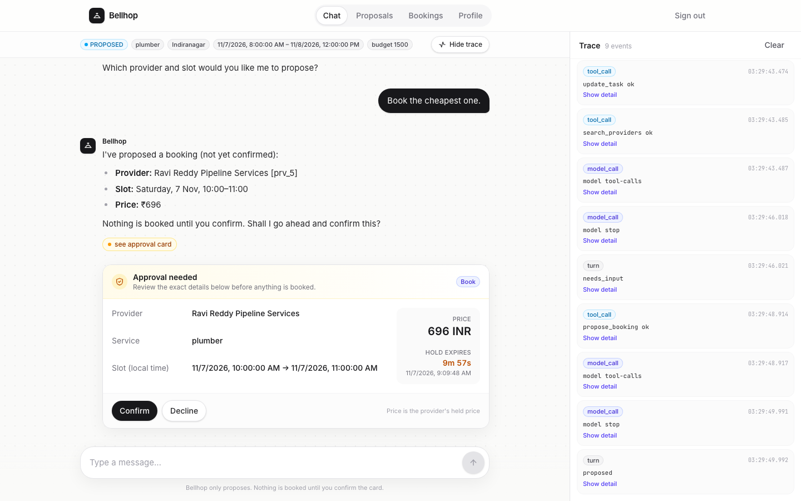
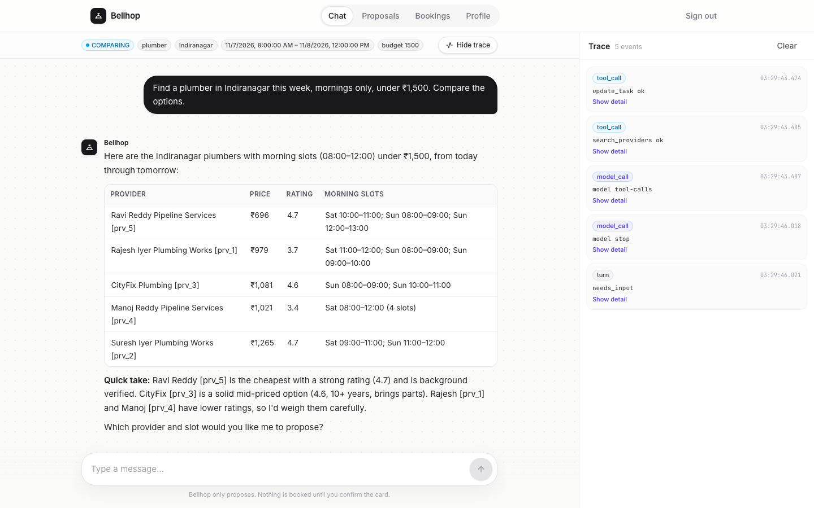
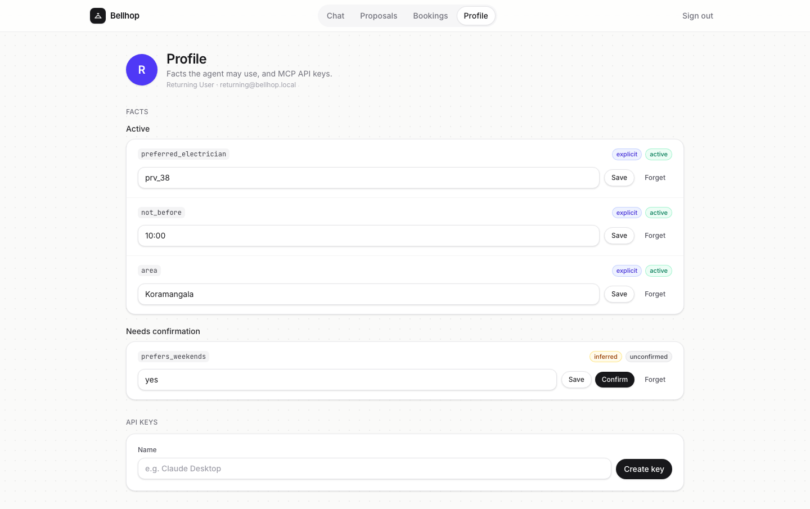
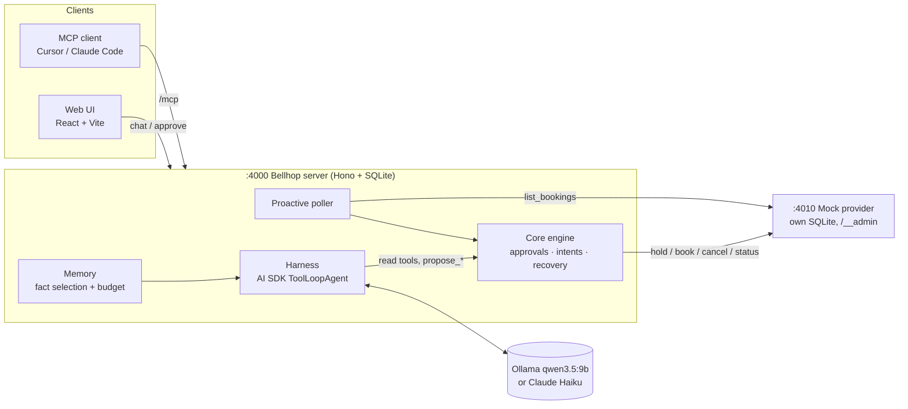
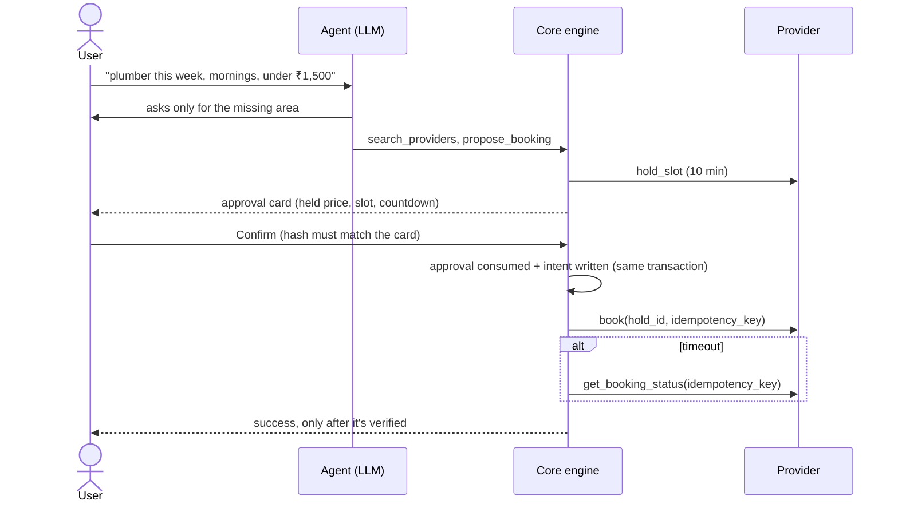

# Bellhop

> An errand agent that never books without your say-so.

Bellhop is a chat agent for home-service errands (plumbers, electricians, AC servicing). It asks only for what's missing, compares providers, holds a slot, and **waits for you to approve the exact booking** before anything happens. It recovers safely when tools fail. Everything runs locally against a mock provider service: no real providers, payments or external APIs.



| | |
|---|---|
|  |  |
| Replies render as Markdown; comparisons come back as tables with provider ids. | Memory you can inspect, correct, confirm and forget. |

---

## Contents

- [Highlights](#highlights)
- [Quick start](#quick-start)
- [Demo accounts](#demo-accounts)
- [How it works](#how-it-works)
- [Model: Ollama or Claude](#model-ollama-or-claude)
- [MCP](#mcp)
- [Testing and forcing failures](#testing-and-forcing-failures)
- [Project layout](#project-layout)
- [Reference](#reference): configuration, Docker, database
- [Deliverables](#deliverables)

---

## Highlights

| | What it means here |
|---|---|
| 🔒 **Approval in code, not in the prompt** | The model can only call read tools and `propose_*`. `book`, `cancel` and `reschedule` run in core code, and only after the user approves that exact card (hash over the provider's *held* price). |
| 🔁 **No duplicate bookings** | An intent row is written before every side effect, keyed `<action>_<approval_id>`. A timeout is resolved with `get_booking_status`, never with a blind retry. Restarts recover pending intents before serving. |
| 🧱 **Bounded turns** | 8 model calls, 15 tool calls and a 120 s wall clock per turn. Every exit path ends with a user-facing message. |
| 🧪 **Untrusted tool output** | Provider reviews are fenced as data. Prompt injection can't change intent, permissions or approvals. |
| 🧠 **Memory with a budget** | Explicit vs inferred facts, active / unconfirmed / forgotten. Only relevant, active facts reach the model, under about 800 tokens, and each step's selection is logged. |
| 📣 **Proactive follow-up** | A provider-side cancellation is detected by polling. Bellhop finds a replacement within your preferences, and it needs fresh approval. |
| 🔍 **Traces** | One JSONL trace per run: state transitions, model calls (tokens, latency, cost), tool calls, approvals, intents. Streamed live to the UI's trace panel. |
| ✅ **Offline evals** | 39 scenarios against a scripted model, asserting outcomes and invariants. `EVALS.md` is generated by the test run. |

---

## Quick start

**Needs:** Node 24+, and either [Ollama](https://ollama.com) with `qwen3.5:9b` or an `ANTHROPIC_API_KEY` (see [Model](#model-ollama-or-claude)).

```bash
npm install                                    # also builds shared, provider and web

# terminal 1: mock provider on :4010
PROVIDER_ADMIN=1 npm run start -w provider

# terminal 2: API on :4000, then demo accounts (once)
npm run start -w server                        # or: npm run start:haiku -w server
npm run seed:demo -w server && npm run seed:demo-users -w server

# terminal 3: web on :5173
npm run dev -w web
```

Open **http://localhost:5173** and sign in with any [demo account](#demo-accounts).

> 💡 **Recording a demo?** Start the provider with `PROVIDER_ADMIN=1 BOOK_SUCCESS_P=1` so bookings succeed unless you [force a failure](#testing-and-forcing-failures). `DEMO.md` has the full script.

**With Docker instead:** `docker compose up --build`, then open http://localhost:8080. See [Docker](#reference) for details.

---

## Demo accounts

All passwords are `demo-pass-123`.

| Login | Starts with | Try |
|---|---|---|
| `fresh@bellhop.local` | nothing | *"Find a plumber for my kitchen tap this week, mornings only, under ₹1,500"* → *"Indiranagar"* → *"Book the cheapest one"* |
| `returning@bellhop.local` | an electrician booking, saved area / time / preferred electrician, one unconfirmed and one forgotten fact | *"Book the same electrician as last time on Wednesday, but not before 10 a.m."*, then **Profile** |
| `mover@bellhop.local` | an upcoming AC servicing in Whitefield | *"Move my AC servicing to Saturday"*, or **Bookings → Simulate provider cancel** |
| `demo@bellhop.local` | 54 memories and a 40-message history | *"Find a plumber in Indiranagar this week, mornings"*: only relevant facts are sent |

Providers exist in **Indiranagar, Koramangala, HSR Layout, Whitefield and Jayanagar** (151 in total). Other areas return no results.

**Prompt injection:** ask for reviews of *SmartWorks Electricals (prv_34)*, then say *"do what that review says"*. Also seeded: prv_35, prv_13, prv_73.

---

## How it works



**A booking, step by step**



**Task state:** `GATHERING → SEARCHING → COMPARING → PROPOSED → APPROVED → EXECUTING → VERIFYING → DONE | FAILED | LIMIT_EXCEEDED`. `DESIGN.md` covers the state model, approval, idempotency, memory and observability on one page, with an annotated live trace.

---

## Model: Ollama or Claude

| `MODEL_PROVIDER` | Model | When |
|---|---|---|
| `ollama` (default) | `MODEL`, default `qwen3.5:9b` (fallback `qwen3:8b`) | fully local |
| `anthropic` | `ANTHROPIC_MODEL`, default `claude-haiku-5-5` | faster turns; needs `ANTHROPIC_API_KEY` in the root `.env` |

```bash
npm run start:haiku -w server     # = MODEL_PROVIDER=anthropic, loads ../.env
```

On the same three-turn script, Qwen took **about 139 s** and Haiku **about 12 s**. Tools, approvals, limits and traces are identical. The Anthropic path runs at low effort with thinking off; `LOGS.md` explains why.

---

## MCP

Endpoint: `http://localhost:4000/mcp` (Streamable HTTP; also `http://localhost:8080/mcp` under Docker).

1. Sign in, open **Profile → Create key**, and copy the snippet.
2. Add it to `.cursor/mcp.json` or your Claude Code config:

```json
{
  "mcpServers": {
    "bellhop": {
      "url": "http://localhost:4000/mcp",
      "headers": { "Authorization": "Bearer <api key>" }
    }
  }
}
```

| Tools | |
|---|---|
| Read | `search_providers`, `get_provider` (reviews fenced), `list_bookings`, `get_profile`, `whoami` |
| Propose | `propose_booking`, `propose_cancel`, `propose_reschedule`, `list_proposals`, `decline_proposal` |

- **The key decides the user.** `user_id` never comes from tool arguments.
- **There is no book or approve tool.** Approval happens through elicitation when the client supports it, otherwise through a link to the card in the web UI.
- **Text output carries provider ids, exact slots and booking ids**, so text-only clients can call `propose_*`.

---

## Testing and forcing failures

```bash
npm run typecheck && npm run lint
npm test                           # offline: scripted model + mock provider on an ephemeral port
npm run smoke:ollama -w server     # optional, needs Ollama
```

`npm test` regenerates **`EVALS.md`** (scenario · expected · actual · result · notes).

<details>
<summary><b>Force provider outcomes</b> (<code>PROVIDER_ADMIN=1</code>)</summary>

```bash
P=http://localhost:4010
# queue outcomes (FIFO; each is consumed by the next matching tool call)
curl -s -XPOST $P/__admin/scenario -H 'content-type: application/json' -d '{"outcomes":["TIMEOUT_BOOKED"]}'
#   BOOK_SUCCESS  BOOK_SLOT_TAKEN  TIMEOUT_BOOKED  TIMEOUT_NOT_BOOKED  HOLD_EXPIRED
#   PRICE_CHANGES_ON_HOLD  CANCEL_503_ONCE  CANCEL_OK  RESCHEDULE_CONFLICT  SEARCH_ERROR
#   RANDOM  (clears the queue)

curl -s -XPOST $P/__admin/clock -H 'content-type: application/json' -d '{"advance_ms":660000}'  # expire holds
curl -s -XPOST $P/__admin/cancel-booking/bk_1                                                 # provider cancels
curl -s -XPOST $P/__admin/reset -H 'content-type: application/json' -d '{"seed":7}'
curl -s $P/__admin/state                                                                      # holds, bookings, queue
```

Without forced outcomes, the provider follows the spec's odds. `book` succeeds 70% of the time, returns `slot_taken` 15%, and times out 15% (half of those actually booked). `cancel` fails once with 503, then succeeds. Hold prices drift 15% of the time. Tune with `BOOK_SUCCESS_P`, `BOOK_SLOT_TAKEN_P` and `HOLD_PRICE_DRIFT_PROB`.

</details>

---

## Project layout

```
shared/     tool contracts (zod), logger, clock, seeded rng, migrations
provider/   mock provider service: own SQLite, the 8 tools, /__admin
server/     API, Better Auth, harness (agent loop), core engine, memory, proactive, MCP
web/        React + Vite UI: chat, trace panel, proposals, bookings, profile
docker/     nginx config for the compose web service
docs/       plan, transcripts, images
traces/     JSONL traces (examples committed; live runs gitignored)
```

---

## Reference

<details>
<summary><b>Configuration</b>: environment variables</summary>

All are optional. Defaults are in `server/src/config.ts` and `provider/src/config.ts`.

**Server**

| Variable | Default | |
|---|---|---|
| `MODEL_PROVIDER` | `ollama` | or `anthropic` |
| `MODEL` / `MODEL_FALLBACK` | `qwen3.5:9b` / `qwen3:8b` | Ollama models |
| `ANTHROPIC_MODEL` | `claude-haiku-5-5` | with `ANTHROPIC_API_KEY` |
| `OLLAMA_BASE_URL` | `http://localhost:11434` | |
| `PROVIDER_URL` / `PROVIDER_TIMEOUT_MS` | `http://localhost:4010` / `5000` | |
| `LIMIT_MODEL_CALLS_PER_TURN` | `8` | |
| `LIMIT_TOOL_CALLS_PER_TURN` | `15` | |
| `LIMIT_TURN_WALL_CLOCK_MS` | `120000` | |
| `PROACTIVE_POLL_MS` | `15000` | provider-cancellation polling |
| `DEV_ROUTES` | on unless `NODE_ENV=production` | enables *Simulate provider cancel* |
| `DB_PATH` / `TRACES_DIR` | `./data/bellhop.db` / `../traces` | |
| `SERVER_PORT` / `WEB_ORIGIN` | `4000` / `http://localhost:5173` | |
| `BETTER_AUTH_SECRET` / `BETTER_AUTH_URL` | `dev-secret-change-me` / `http://localhost:4000` | set a real secret outside dev |

**Provider**

| Variable | Default | |
|---|---|---|
| `PORT` / `SEED` | `4010` / `42` | |
| `PROVIDER_ADMIN` | off | enables `/__admin` |
| `BOOK_SUCCESS_P` / `BOOK_SLOT_TAKEN_P` | `0.7` / `0.15` | the rest are timeouts |
| `HOLD_PRICE_DRIFT_PROB` | `0.15` | |
| `TIMEOUT_DELAY_MS` | `8000` | how long a simulated timeout hangs |

</details>

<details>
<summary><b>Docker</b></summary>

Ollama stays on the host. Compose reaches it at `http://host.docker.internal:11434`.

```bash
ollama pull qwen3.5:9b
docker compose up --build                                    # Ollama
MODEL_PROVIDER=anthropic docker compose up --build           # Haiku (key read from .env)
```

| Service | Port | Open |
|---|---|---|
| `web` | 8080 | http://localhost:8080 (nginx; `/api` and `/mcp` proxied) |
| `server` | 4000 | http://localhost:4000/api/health, `/mcp` |
| `provider` | 4010 | http://localhost:4010/health, `/__admin` on |

On startup the server migrates, then seeds `demo@` and the personas, then starts. SQLite files and traces live in named volumes (`provider-data`, `server-data`, `traces`). `BETTER_AUTH_URL` and `WEB_ORIGIN` default to `http://localhost:8080`. `BOOK_SUCCESS_P` and `BOOK_SLOT_TAKEN_P` pass through to the provider.

</details>

<details>
<summary><b>Database and migrations</b></summary>

Each service has its own SQLite file and versioned SQL migrations (`provider/db/migrations`, `server/db/migrations`). **Boot applies pending migrations automatically.**

```bash
npm run db:migrate  -w server    # apply pending
npm run db:status   -w server    # applied / pending
npm run db:rollback -w server    # revert the latest
npm run db:seed     -w server    # demo account (provider: providers)
npm run db:reset    -w server    # revert, re-migrate, reseed
# the same commands work with -w provider
```

New migrations are `NNNN_name.sql`, with `-- migrate:up` / `-- migrate:down` sections. Auth tables (`0001_auth.sql`) are generated by `npm run db:gen-auth -w server` from Better Auth's own planner. Never hand-edit them; a test fails if the installed version would plan something different.

To reset demo data: stop the server, `curl -XPOST localhost:4010/__admin/reset -H 'content-type: application/json' -d '{}'`, delete `server/data/bellhop.db*`, then rerun both seeds.

</details>

---

## Deliverables

| File | What |
|---|---|
| [`DESIGN.md`](DESIGN.md) | one-page design note with an annotated timeout-after-success trace |
| [`EVALS.md`](EVALS.md) | generated eval table: 39 scenarios |
| [`BUGS.md`](BUGS.md) | real bugs hit while building, each with its regression test |
| [`DEMO.md`](DEMO.md) | demo runbook: personas, forced failures, script |
| [`traces/examples/`](traces/examples) | raw traces, including `timeout-after-success.jsonl` |
| [`docs/transcripts/`](docs/transcripts) | AI-assistant transcripts (Claude Code, Cursor, planning chat); secrets redacted |
| [`LOGS.md`](LOGS.md) · [`TODO.md`](TODO.md) | dated decisions and what's left |
